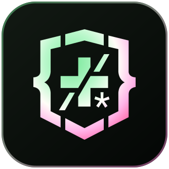
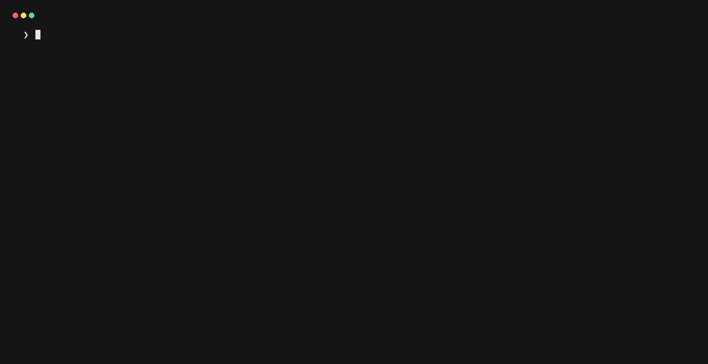

<div align="center">
  
  <h1>Code Buster</h1>
  <p>Repository-aware static analysis for AI-assisted development.</p>
  <p>
    <a href="https://toolbunker.dev/codebuster/">Overview</a>
    ·
    <a href="https://toolbunker.dev/codebuster/docs/getting-started/installation">Install</a>
    ·
    <a href="https://toolbunker.dev/codebuster/docs/">Docs</a>
    ·
    <a href="CONTRIBUTING.md">Contribute</a>
  </p>
</div>

Code Buster gives developers and coding agents deterministic feedback about a
repository. It runs locally, does not upload source code, and does not call an
AI provider.

<p align="center">
  
</p>

## Install

On Apple Silicon macOS:

```sh
brew install tool-bunker/tap/code-buster
```

With Rust 1.88 or newer:

```sh
cargo install code-buster --locked
```

The [installation guide](https://toolbunker.dev/codebuster/docs/getting-started/installation)
also covers native macOS, Linux, and Windows installers.

## Run

From a repository root:

```sh
cb
```

Useful focused commands:

```sh
cb review --pr
cb quality --structure
cb duplication
cb graph
cb update
```

Configuration is optional. Run `cb init` for a commented starter configuration,
or choose an opinionated profile such as `cb init rust`, `cb init bevy`,
`cb init python`, or `cb init typescript`.

## What it finds

Code Buster combines file-level rules with repository-wide analysis:

- dependency cycles and architecture violations;
- production dependencies on test code;
- duplicated and unreachable code;
- complexity growth and maintenance hotspots;
- correctness, security, accessibility, and performance risks;
- repository structure and framework drift.

Findings include evidence and remediation guidance. They are review signals,
not proof that code is wrong.

## Where it fits

Code Buster complements compilers, type checkers, linters, tests, formatters,
and specialist security scanners. Use it for the repository-level and
cross-file context those tools often do not cover.

It supports Rust, JavaScript, TypeScript, Python, Dart, Java, C#, C and C++,
Go, Shell, and other languages. See the
[language matrix](https://toolbunker.dev/codebuster/docs/reference/languages)
for current coverage.

Code Buster remains pre-1.0. Evaluate its findings and integrations before
using it as a blocking production quality gate.

## Documentation

- [Quickstart](https://toolbunker.dev/codebuster/docs/getting-started/quickstart)
- [Commands](https://toolbunker.dev/codebuster/docs/reference/commands)
- [Configuration](https://toolbunker.dev/codebuster/docs/guides/configuration)
- [Reports](https://toolbunker.dev/codebuster/docs/reference/reports)
- [Integrations](https://toolbunker.dev/codebuster/docs/guides/integrations)

## Development

```sh
cargo build --release --locked
./target/release/cb version
```

Read [CONTRIBUTING.md](CONTRIBUTING.md) for project structure, verification,
and release instructions.
